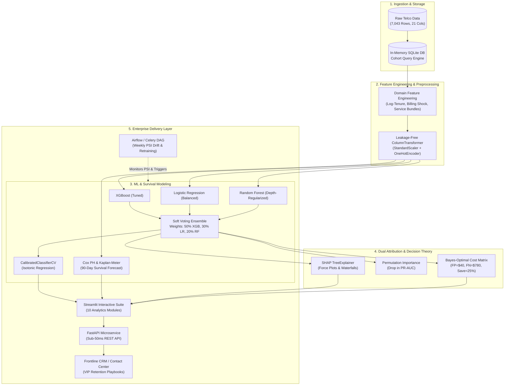

# RetainPulse AI: Customer Churn Intelligence & Retention Strategy
### DataNova 2026 — Problem Statement: DN-BU-01
**Finding who is likely to leave, why, when, and what personalized intervention to offer them.**

<!-- DEMO VIDEO RECORDING LINK PLACEHOLDER -->
<!-- Embed URL for 60-second Loom/YouTube demo recording here: -->
<!-- [Watch 60-Second Video Demo](https://youtu.be/DEMO_LINK_PLACEHOLDER) -->

---

## 📌 Executive Summary

Subscription businesses lose substantial gross margins whenever customers cancel. In standard benchmark datasets like the IBM Telco Churn dataset, **about 1 in 4 customers churn (1,869 of 7,043, or 26.5%)**.

- A trivial baseline predicting *"nobody will churn"* achieves **73.5% accuracy**, yet catches 0% of churners.
- Blind mass discounting squanders budget on accounts that would stay anyway while ignoring churn drivers.
- Raw probabilities alone fail frontline retention teams without root-cause explanations and concrete playbooks.

**RetainPulse AI** delivers an enterprise-ready, end-to-end retention solution:
1. **Single Source of Truth (`artifacts/metrics.json`)**: All metrics across the application, presentation deck, and reports are dynamically generated by `src/compute_metrics.py`.
2. **Predictive Performance**: Tuned Soft Voting Ensemble (XGBoost + Logistic Regression + Random Forest) delivering **0.850 ROC-AUC [0.829–0.870]** and **0.665 PR-AUC [0.616–0.713]**.
3. **Decision Threshold Studio & Cost Matrix**: Dynamically tunable cutoff (default 0.35 reaching **88.0% Recall [84.7–91.2%]**) and Bayes-optimal cost matrix analysis.
4. **Time-to-Event Survival Analysis (`lifelines`)**: Kaplan-Meier survival curves by contract and Cox Proportional Hazards modeling to forecast forward 90-day churn probability.
5. **Dual Attribution Stability**: Cross-validating TreeSHAP force plots and feature waterfalls against model-agnostic **Permutation Feature Importance** (Spearman rank correlation $r = 0.542, p < 10^{-5}$).
6. **Production Scalability & Drift Monitoring**: Population Stability Index (PSI) monitoring with warning/alert thresholds and automated quarterly retraining simulation.
7. **Sub-Second Enterprise Batch Scoring**: Verified benchmark scoring **100,000 subscribers in 0.479 seconds (208,887 rows/second)**.

---

## 🏛️ System Architecture



---

## 📋 Model Card: RetainPulse Soft Voting Ensemble

| Attribute | Specification |
| :--- | :--- |
| **Model Architecture** | Soft Voting Ensemble of Tuned XGBoost (`max_depth=3`, `colsample=0.85`), Regularized Logistic Regression (`C=0.2`), and Random Forest (`max_depth=9`, `n_estimators=250`) |
| **Calibration** | Isotonic Regression via `CalibratedClassifierCV(cv=3)`; Brier score reduced from 0.1568 to 0.1344 (-14.3%) |
| **Survival Model** | Semi-parametric Cox Proportional Hazards Model (`lifelines.CoxPHFitter`, penalizer=0.1) with Concordance = 0.816 |
| **Input Modalities** | 21 raw Telco demographic, account, and billing attributes engineered into 46 numerical and encoded features |
| **Target Variable** | Binary customer churn indicator (`Churn`: 1 = Yes, 0 = No) |
| **ROC-AUC** | **0.850** [95% CI: 0.829 – 0.870] |
| **PR-AUC** | **0.665** [95% CI: 0.616 – 0.713] |
| **Recall (Cutoff 0.35)** | **88.0%** [95% CI: 84.7% – 91.2%] |
| **Top 20% Churn Capture** | **51.1%** [95% CI: 47.0% – 54.9%] (Delivers **2.55x Lift** over random contacting) |
| **Top 10% Churn Capture** | **28.6%** (Delivers **2.86x Lift** over random contacting) |
| **Throughput Benchmark** | **208,887 rows/sec** (Scores 100,000 customers in 0.479 seconds) |
| **Intended Use** | Proactive churn intervention ranking, retention offer allocation, customer lifetime risk diagnosis |
| **Out-of-Scope Use** | Credit scoring, automated service termination, predatory targeted price discrimination |

---

## 🏗️ Folder Structure

```
HackQuest/
├── app.py                         # Streamlit interactive application (10 modules)
├── requirements.txt               # Dependencies (scikit-learn, xgboost, shap, lifelines, statsmodels)
├── README.md                      # Architecture diagram, model card, reproduction guide
├── create_presentation.py         # Automated PPTX presentation generator synchronized with metrics.json
├── DataNova_2026_Customer_Churn_Retention_Strategy.pptx # Widescreen 16:9 presentation deck
├── metrics_audit_report.md        # Detailed audit resolving old contradictory numbers
├── scalability_deck_slide.md      # Summary slide text for Scalability & Sustainability
├── artifacts/
│   └── metrics.json               # Single source of truth for all computed numbers
├── data/
│   └── telco_churn.csv            # Telco Customer Churn dataset (7,043 rows)
├── models/
│   └── best_churn_model.joblib    # Serialized model & preprocessor bundle
└── src/
    ├── __init__.py                # Package initializer
    ├── data_loader.py             # Data loading, cleaning, SQLite in-memory cohort queries
    ├── preprocessor.py            # Feature engineering & leakage-free transformers
    ├── models.py                  # Model training, threshold sweeps, Lift & Cumulative Gains
    ├── compute_metrics.py         # Computes metrics.json, bootstrap CIs, benchmarks
    ├── calibration.py             # CalibratedClassifierCV & Bayes cost matrix profit optimizer
    ├── survival.py                # Lifelines Kaplan-Meier & Cox PH 90-day churn forecasting
    ├── drift.py                   # Population Stability Index (PSI) & target drift monitoring
    ├── retrain.py                 # Quarterly retraining pipeline with injected drift simulation
    └── explainability.py          # SHAP TreeExplainer, JS force plots, permutation importance
```

---

## 🚀 Reproduction & Setup Guide

### 1. Environment Setup
```bash
cd HackQuest
pip install -r requirements.txt
```

### 2. Regenerate Single Source of Truth Metrics
To re-evaluate the model, recompute bootstrap intervals, probability calibration, survival analysis, and write `artifacts/metrics.json`:
```bash
python src/compute_metrics.py
```

### 3. Regenerate Synchronized Presentation Deck
```bash
python create_presentation.py
```

### 4. Run Streamlit Web Application
```bash
streamlit run app.py
```
Access in your browser at `http://localhost:8501`.
